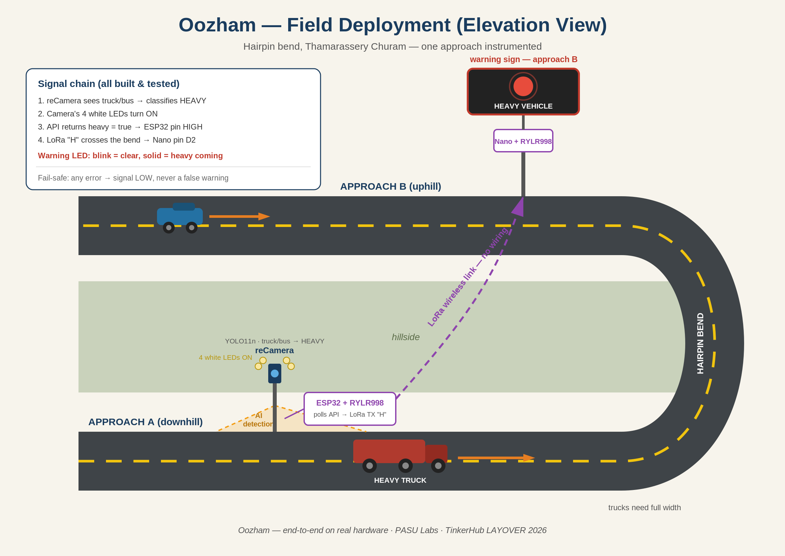

# Oozham (ഊഴം)

> **Your turn, at every hairpin.**

An AI warning system for hairpin bends on ghat roads. A camera spots trucks and buses before the bend, and a LoRa radio link sends the warning to a light on the other side, so drivers there wait.

Built by **PASU Labs** for **TinkerHub LAYOVER 2026** (TinkerSpace Calicut). Theme: Travel.



---

## Problem Statement

Hairpin bends on ghat roads like Thamarassery Churam are narrow. A loaded truck or bus needs the **whole width of the road** to turn. If another vehicle comes in from the other side, neither one can reverse, and the road locks up.

**July 2026, Thamarassery Ghat:**
- One multi-axle truck got stuck at the 4th hairpin and caused a **10+ hour gridlock**
- Thousands of travellers stranded, ambulances delayed
- Airport passengers walked uphill to find other transport
- The Churam Samrakshana Samithi said jams like this could be avoided if traffic on the other side was held back while a heavy vehicle was on the bend

**Why existing systems are not enough**

| System | What it does | What it misses |
|---|---|---|
| Valparai ghat sensors (TN, 5th hairpin) | Warns that a vehicle is coming | Doesn't say who should wait |
| #RoadsThatHonk (Patnitop, J&K) | Audio/visual alert at bends | Doesn't say who should wait |
| **Oozham** | **Tells the other side to wait when a heavy vehicle is turning** | — |

---

## Proposed Solution

1. A **reCamera** before the bend watches the road with a YOLO11n model
2. Truck or bus spotted → camera turns on its **4 white LEDs** and sets `heavy = true` on its API
3. An **ESP32** reads the API and raises a digital signal
4. A **LoRa transmitter** sends the warning across the bend (no cables)
5. A **LoRa receiver** on the far side drives a **warning light**: blinks when the road is clear, stays solid when a heavy vehicle is coming

No internet, no cables across the bend, no router on site.

---

## Technical Implementation

### Hardware used

| Component | Role |
|---|---|
| Seeed reCamera 2002w | Runs YOLO11n, detects truck/bus as HEAVY, lights its 4 white LEDs |
| ESP32 | Hosts a private WiFi network, polls the camera API every 200 ms, drives pin D0 |
| Seeed Xiao nRF52840 + RYLR998 | LoRa transmitter, sends `H` while D0 is HIGH |
| Arduino Nano + RYLR998 | LoRa receiver on the far side of the bend |
| LED (Nano D2) | Warning light: blink = clear, solid = heavy vehicle |

### Signal chain

```
reCamera (YOLO11n)  --truck/bus-->  4 white LEDs ON
        |  Node-RED API: GET /api/heavy -> true / false
        v
ESP32  (WiFi AP "HeavyCam_AP" 192.168.4.1, camera at fixed IP 192.168.4.2)
        |  polls every 200 ms -> D0 HIGH on heavy, LOW on any error
        v
Xiao nRF52840 + RYLR998  -->  LoRa "H" packets while D2 is HIGH
        |  (address 0, network ID 10, 115200 baud)
        v
Arduino Nano + RYLR998  -->  D2 LED: blink = clear, solid = heavy
```

### Repository structure

```
node-red/heavy_vehicle_flow.json            reCamera Node-RED flow (detection, LEDs, API, dashboard)
firmware/esp32-bridge/HeavyCamBridge.ino    ESP32: WiFi AP + API polling -> D0
firmware/transmitter/LoRa_Transmitter.ino   Xiao nRF52840: D2 input -> LoRa "H"
firmware/receiver/LoRa_Receiver.ino         Arduino Nano: LoRa -> D2 warning LED
docs/oozham_deployment.png / .svg           Field deployment diagram
docs/Oozham.docx                            Project document
```

### Camera API (Node-RED on port 1880)

| Endpoint | Returns |
|---|---|
| `GET /api/heavy` | `true` or `false` (used by the ESP32) |
| `GET /api/vehicle` | `{"heavy": true}` / `{"heavy": false}` |

### Wiring

| From | To |
|---|---|
| ESP32 D0 | Xiao D2 |
| ESP32 GND | Xiao GND |
| Xiao D9 | RYLR998 (TX) TX |
| Xiao D10 | RYLR998 (TX) RX |
| Nano D4 | RYLR998 (RX) TX |
| Nano D5 | RYLR998 (RX) RX |
| Nano D2 | Warning LED (+ resistor) to GND |

### Setup

1. **reCamera:** open Node-RED at `http://<camera-ip>:1880`, go to Menu → Import, pick `node-red/heavy_vehicle_flow.json`, then Deploy
2. **ESP32:** flash `HeavyCamBridge.ino`. It creates the WiFi network `HeavyCam_AP`
3. **reCamera network:** join `HeavyCam_AP`, set static IP `192.168.4.2`, gateway `192.168.4.1`
4. **Xiao:** flash `LoRa_Transmitter.ino`
5. **Nano:** flash `LoRa_Receiver.ino`
6. **Test:** show a truck/bus to the camera. The camera LEDs turn on, `/api/heavy` returns `true`, ESP32 D0 goes HIGH, and the Nano LED goes from blinking to solid

### Design decisions

- **Fixed IPs on a private AP:** the API address never changes, and no router is needed on site
- **Fail-safe:** if WiFi or the API fails, the ESP32 drops D0 LOW, so a broken link never shows a false warning
- **3 s hold:** the camera keeps `heavy = true` for 3 s after the last detection, so the signal doesn't flicker between frames
- **Tolerant receiver:** the Nano treats any LoRa packet as signal activity, because SoftwareSerial at 115200 baud can garble data

---

## Impact

- **Stops the deadlock before it starts:** drivers on the far side wait while a heavy vehicle uses the full width of the bend
- **Answers a real, documented problem:** the July 2026 Thamarassery gridlock, and the local Samithi's own request
- **Who benefits:** travellers save hours, ambulances get through, and less fuel is burned idling in jams
- **Low cost and off-grid friendly:** off-the-shelf parts, no internet, no cables across the bend

### What comes next

- A camera on the other approach for two-way detection
- Full STOP / GO signboards instead of a single LED
- Ambulance priority and control-room alerts
- Solar power for remote ghat locations

---

## Hackathon Tracks (TinkerHub LAYOVER 2026)

| Track | Fit | Why |
|---|---|---|
| 05 Travel hardware & IoT | Primary | reCamera + ESP32 + LoRa + LED, a real roadside device |
| 03 Navigation & mobility | Primary | Keeps traffic moving through ghat hairpins |
| 02 AI-powered travel experiences | Secondary | YOLO11n edge AI spots heavy vehicles |
| 01 Travel utilities & tools | Secondary | Saves travellers hours stuck at Thamarassery Churam |
| 07 Accessibility & sustainable travel | Secondary | Keeps emergency routes open, cuts fuel wasted idling |

---

## Sources

- Onmanorama, 24 Jul 2026: [Midnight gridlock on Thamarassery Ghat leaves thousands stranded](https://www.onmanorama.com/news/kerala/2026/07/24/midnight-gridlock-on-thamarassery-ghat-leaves-thousands-stranded-traffic-snarl-persists-for-over-10-hours.html)
- Times of India, 24 Jul 2026: [Heavy traffic snarl on Thamarassery ghat road, hundreds stranded](https://timesofindia.indiatimes.com/city/kozhikode/heavy-traffic-snarl-on-thamarassery-ghat-road-hundreds-stranded/articleshow/132609630.cms)
- The Hindu, 2021: Valparai ghat sensor and display board at the 5th hairpin
- HP Lubricants, 2017: #RoadsThatHonk, Patnitop, J&K

---

**Team:** PASU Labs (Madhav)
